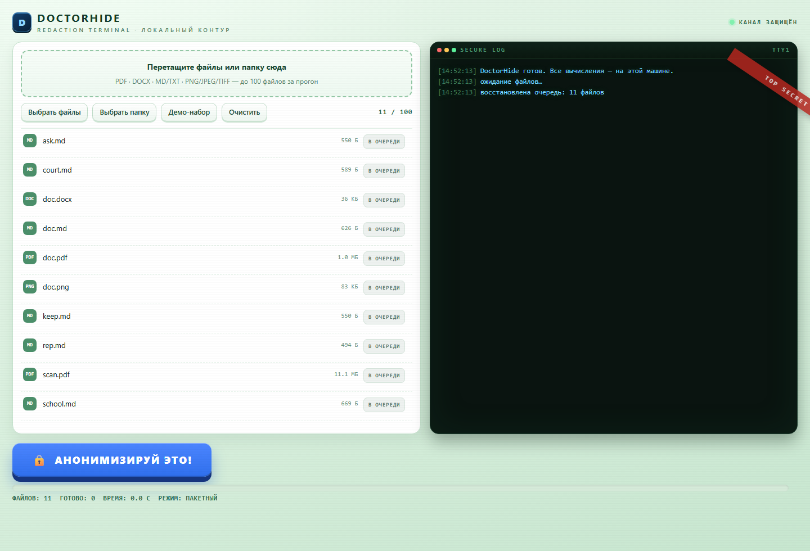
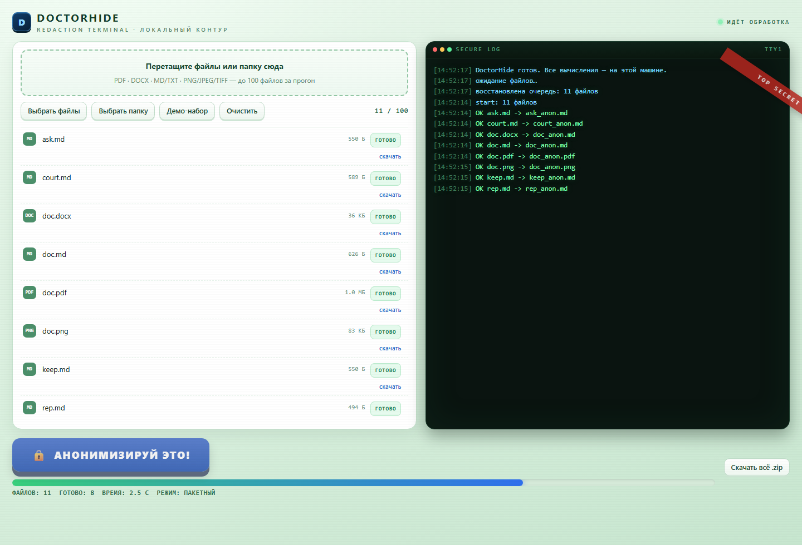
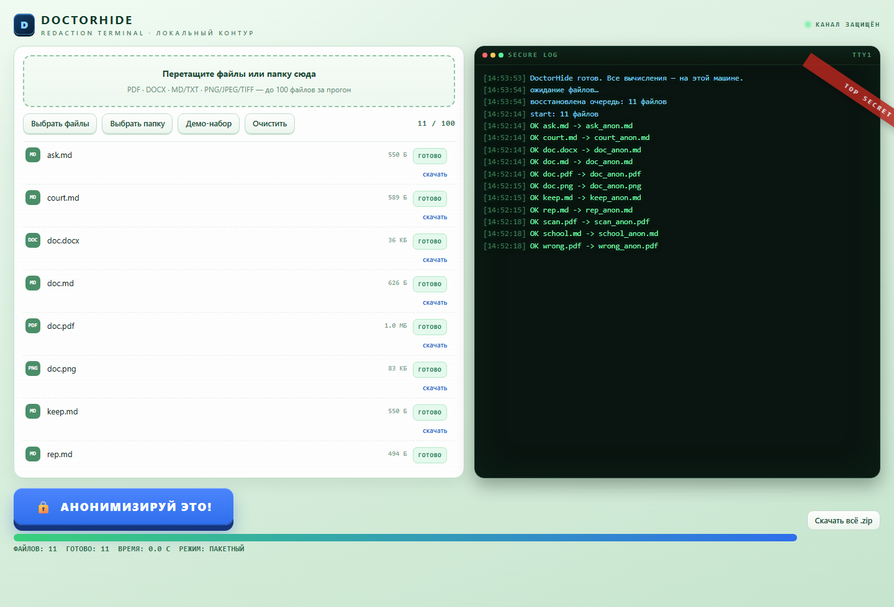

# DoctorHide GUI

Локальный терминал обезличивания в браузере: пакетная обработка до 100 файлов за прогон.

## Запуск

```bash
python gui/server.py            # http://127.0.0.1:8765/
python gui/server.py --port 9000
```

Сервер слушает только `127.0.0.1`: файлы не покидают машину, всё считается локально.
Обработка — те же функции, что в `doctorhide.py`, никакой отдельной логики.

## Что умеет

- **До 100 файлов за раз**, смешанные форматы в одной очереди: PDF, DOCX, MD/TXT, PNG/JPEG/TIFF/BMP/WEBP;
- загрузка **файлами, папкой или перетаскиванием** (drag&drop);
- кнопка **«Анонимизируй это!»** запускает обработку всей очереди;
- **живой журнал**: `start: 11 файлов`, `OK doc.pdf -> doc_anon.pdf`, ошибки красным;
- состояние каждого файла: `в очереди` → `обработка` → `готово` / `ошибка`;
- прогресс-бар и счётчики: файлов, готово, время;
- скачивание результатов по одному или общим архивом `doctorhide_results.zip`;
- очередь восстанавливается после перезагрузки страницы;
- «Демо-набор» — кладёт в очередь тестовые файлы из `_private/_selftest`.

## Скриншоты

| Очередь | Обработка | Готово |
|---|---|---|
|  |  |  |

## Как устроено

```
gui/server.py     локальный HTTP-сервер (стандартная библиотека, без зависимостей)
gui/index.html    интерфейс: тёмная консоль, мягкий зелёный фон, синяя кнопка
gui/screens/      снимки интерфейса
_gui_work/        рабочая папка прогона (в .gitignore)
```

Эндпойнты: `POST /api/add` (файл в очередь), `POST /api/demo`, `POST /api/run`,
`GET /api/status`, `GET /api/log`, `GET /api/download/<id>`, `GET /api/zip`, `POST /api/clear`.

## Ограничения

- обработка последовательная: 100 файлов со сканами могут считаться минуты;
- интерфейс не имеет авторизации — не выставляйте порт наружу;
- результаты лежат в `_gui_work/out` до очистки очереди.
